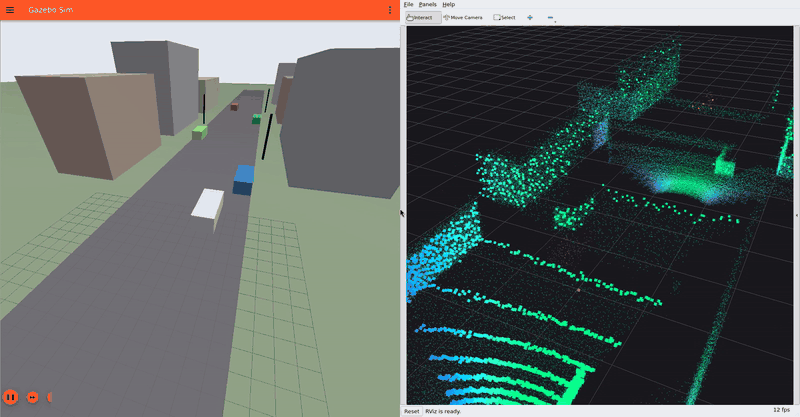
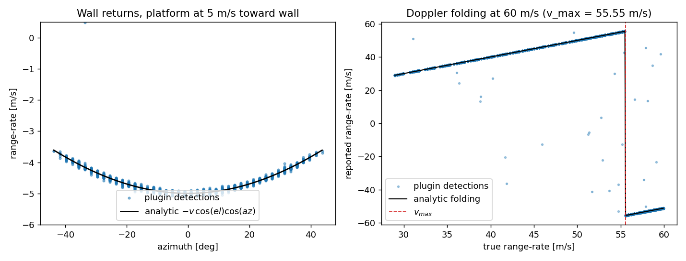

# Gazebo 4D Imaging Radar Plugin

[](https://docs.ros.org/en/jazzy/)
[-orange.svg)](https://gazebosim.org/)
[](#validation)
[](LICENSE)

A Gazebo Sim system plugin that simulates a **4D FMCW MIMO automotive imaging radar**
(Continental ARS548-class, 77 GHz). Every cycle it ray-casts the **actual collision
geometry** of the world and reports per-detection range, azimuth, elevation, RCS and an
**exact range-rate (Doppler)** — including Doppler folding beyond the unambiguous
velocity — over standard ROS 2 interfaces.

It is built for developing and testing **radar ego-velocity estimators** (Kellner-style
3-point Doppler RANSAC), radar-inertial odometry and radar perception pipelines, where
the solver must behave the same in simulation as on hardware.



*[Street demo](gazebo_4d_radar_plugin/examples/): the radar on a car driving down a street.
Static objects (green/cyan) all close at the car's own speed; the oncoming car (orange)
stands out by its Doppler alone. Run it with
`ros2 launch gazebo_4d_radar_plugin radar_street_demo.launch.py`.*



*Plugin output inside Gazebo vs. the analytic model. Left: wall returns at 5 m/s follow
r&#775; = −v cos(el) cos(az). Right: at 60 m/s returns beyond v<sub>max</sub> = 55.55 m/s
fold to the negative side. Scattered points are the configured Poisson false detections.*

---

## Features

- **Real scene geometry.** CPU ray caster over every collision in the world: planes,
  oriented boxes, spheres, cylinders and triangle **meshes** (BVH-accelerated, e.g. a
  49k-triangle reconstructed terrain). Capsules/ellipsoids are approximated; heightmaps
  and polylines are not yet supported (a warning is printed).
- **Exact kinematic Doppler.** r&#775; = (v<sub>target point</sub> − v<sub>radar origin</sub>) · û.
  Sensor rotation about its own origin contributes nothing; a mounting lever arm
  contributes ω × r. **Moving targets** use their link's linear *and* angular velocity.
- **Doppler folding** across [−v<sub>max</sub>, +v<sub>max</sub>], switchable.
- **Scatterer model.** Radar-equation 1/R⁴ falloff, incidence angle with a per-surface
  **specularity exponent** (rough terrain returns at grazing angles, smooth water/asphalt
  doesn't), reflectivity, RCS threshold — configurable per model.
- **Sensor non-idealities.** Independent Gaussian noise on range/azimuth/elevation/Doppler,
  quantisation, Poisson false detections, random dropouts, seedable RNG.
- **Explicit mounting pose.** `<mounting_pose>` is applied by the plugin, so downstream
  consumers must not apply it again.
- **Ground truth for solver validation.** The true radar-origin velocity in the radar
  frame is published alongside every scan.
- **Reference ego-velocity solver** (3-point RANSAC + least squares) as a ROS 2 node, and
  an **automated Gazebo validation suite**.

---

## Quick Start (Ubuntu 24.04, ROS 2 Jazzy, Gazebo Harmonic)

```bash
sudo apt install ros-jazzy-ros-gz ros-jazzy-radar-msgs ros-jazzy-rviz2 python3-numpy python3-matplotlib
mkdir -p ~/ros2_ws/src && cd ~/ros2_ws/src
git clone https://github.com/Nandostream11/gz_4d_radar_plugin.git
cd ~/ros2_ws && colcon build && source install/setup.bash
```

Sourcing the workspace sets `GZ_SIM_SYSTEM_PLUGIN_PATH` and `GZ_SIM_RESOURCE_PATH`, so
`gz sim` finds the plugin and the bundled models.

```bash
# Demo: ground, a parked car and a wall, radar tilted 10 deg down; RViz + ego-velocity node
ros2 launch gazebo_4d_radar_plugin radar_sim.launch.py
gz topic -t /model/ego_radar_platform/cmd_vel -m gz.msgs.Twist -p 'linear: {x: 5}'

# Target application: drone at ~30 m AGL, radar tilted 45 deg down over reconstructed terrain
ros2 launch gazebo_4d_radar_plugin radar_sim.launch.py world:=radar_terrain_world.sdf
gz topic -t /model/survey_drone/cmd_vel -m gz.msgs.Twist -p 'linear: {x: 8}'
```

> **WSL users:** WSL appends the Windows `PATH`. If CMake picks up Windows toolchains
> (e.g. Anaconda's protobuf → `#error This file was generated by a newer version of protoc`),
> build with the Windows entries removed:
> `export PATH=$(echo "$PATH" | tr ':' '\n' | grep -v '^/mnt/' | paste -sd:)`

---

## Validation

```bash
colcon test --packages-select radar_physics_core && colcon test-result --verbose   # 18 unit tests
ros2 run gazebo_4d_radar_plugin validate_radar_plugin.py --plot validation.png       # Gazebo, headless
```

The validation script launches Gazebo headless, drives a platform with a known body-frame
velocity, and checks **every detection** against an independently computed expectation.
Results from the last run ([full report](docs/validation_report.json)):

| # | Check (from the design spec) | Result |
|---|---|---|
| 1 | Static platform → all range-rates zero | 99.5 % within 0.2 m/s, residual RMS 0.050 m/s (= configured σ) |
| 2 | Translation toward a wall → cosine profile r&#775; = −v·û | 99.6 % within tolerance, ~144 wall detections/scan |
| 3 | Pure yaw about the radar origin → zero Doppler | 99.3 % within tolerance |
| 4a | 50 m/s (below v<sub>max</sub>) → no folding | 99.5 % within tolerance |
| 4b | 60 m/s (above v<sub>max</sub>) → folding at the right speed and direction | 34 % of returns fold, to the negative side as predicted; 99.5 % match the folded model |
| 5 | Round trip: RANSAC ego-velocity vs truth | median error 0.017 m/s, p95 0.040 m/s |
| 6 | Moving target (box at 4 m/s, parked radar) | 100 % within tolerance |

The ~0.5 % outside tolerance are the injected false detections (2 per scan) and noise
tails. Additional checks run during development: the terrain world (45° mount + lever arm,
49k triangles) recovers the radar velocity with RANSAC to a median 0.032 m/s; the demo
world to 0.016 m/s.

**Performance** (single-threaded, measured on the author's laptop under WSL2): 3600 rays/scan at 20 Hz runs in real time on the
demo world; over the 49k-triangle terrain the real-time factor is ~0.9. Reduce
`<ray_samples_*>` if needed — the estimator cares about detection distribution and Doppler
accuracy, not the device's full angular resolution.

---

## SDF Integration

The plugin is a **model-level** system (SDF does not allow plugins inside `<link>`).
`<link_name>` selects the link that carries the radar (default: canonical link).

```xml
<model name="my_vehicle">
  <link name="base_link"> ... </link>

  <plugin filename="libgazebo_4d_radar_plugin.so"
          name="gazebo_4d_radar_plugin::Gazebo4DRadarPlugin">
    <link_name>base_link</link_name>
    <frame_id>radar_link</frame_id>
    <!-- x y z roll pitch yaw of the radar frame in base_link (applied by the plugin) -->
    <mounting_pose>2.0 0 0.5 0 0.1745 0</mounting_pose>
    <max_range_m>150.0</max_range_m>
    <v_max_mps>55.55</v_max_mps>

    <!-- optional: per-model radar surface properties -->
    <surface model="lake">
      <reflectivity>0.9</reflectivity>
      <incidence_exponent>8.0</incidence_exponent>   <!-- smooth, specular -->
    </surface>
  </plugin>
</model>
```

See [docs/integration_guide.md](docs/integration_guide.md) for multi-radar setups and RViz.

---

## ROS 2 Interfaces

| Topic | Type | Content |
|---|---|---|
| `/radar/scan` | [`radar_msgs/RadarScan`](https://github.com/ros-perception/radar_msgs) | Per detection: range, azimuth, elevation, `doppler_velocity`, `amplitude` (= RCS dBm²) |
| `/radar/points` | `sensor_msgs/PointCloud2` | Fields `x y z doppler range azimuth elevation rcs`, radar frame |
| `/radar/ground_truth_velocity` | `geometry_msgs/TwistStamped` | True radar-origin linear/angular velocity in the radar frame |
| `/radar/ego_velocity` | `geometry_msgs/TwistStamped` | Output of the bundled RANSAC estimator node |

All stamps are simulation time. Frame convention: +x boresight, +y left, +z up; by default
closing targets have **negative** range-rate (`closing_velocity_positive` flips it).

---

## Configuration Parameters

| Parameter | Default | Description |
|---|---|---|
| `<sensor_name>` | `radar` | Name used for the ROS node and log messages |
| `<link_name>` | canonical link | Link carrying the radar |
| `<mounting_pose>` | `0 0 0 0 0 0` | Radar frame relative to the link (applied by the plugin) |
| `<frame_id>` | `radar_link` | `frame_id` of published messages |
| `<scan_topic>` / `<pointcloud_topic>` / `<ground_truth_topic>` | see above | Output topics |
| `<publish_radar_scan>` / `<publish_pointcloud>` / `<publish_ground_truth>` | `true` | Enable outputs |
| `<cycle_rate_hz>` | `20.0` | Scan rate |
| `<max_range_m>` / `<min_range_m>` | `300.0` / `0.2` | Range window |
| `<fov_azimuth_rad>` / `<fov_elevation_rad>` | `2.0944` / `0.5236` | Full field of view (120° × 30°) |
| `<ray_samples_azimuth>` / `<ray_samples_elevation>` | `120` / `30` | Ray-fan density |
| `<v_max_mps>` | `55.55` | Max unambiguous range-rate |
| `<enable_doppler_folding>` | `true` | Fold range-rate into [−v<sub>max</sub>, v<sub>max</sub>] |
| `<closing_velocity_positive>` | `false` | Sign convention of range-rate |
| `<range_sigma_m>` / `<azimuth_sigma_rad>` / `<elevation_sigma_rad>` / `<range_rate_sigma_mps>` | `0.05` / `0.0052` / `0.0105` / `0.05` | Gaussian noise σ |
| `<range_resolution_m>` / `<azimuth_resolution_rad>` / `<elevation_resolution_rad>` / `<range_rate_resolution_mps>` | `0.02` / `0.00175` / `0.00349` / `0.01` | Reported quantisation (0 = off) |
| `<min_rcs_threshold>` | `-25.0` | Detection threshold on apparent RCS (dBm²) |
| `<power_falloff_exponent>` | `4.0` | Range falloff exponent |
| `<false_detection_rate_per_cycle>` | `2.0` | Mean Poisson clutter detections per scan |
| `<detection_dropout_probability>` | `0.03` | Probability of dropping a true detection |
| `<random_seed>` | time-based | Seed for reproducible runs |
| `<ignore_own_model>` | `true` | Ignore collisions of the model carrying the radar |
| `<publish_tf>` / `<tf_parent_frame>` | `false` / `world` | Broadcast `tf_parent_frame → frame_id` from the true radar pose (handy for RViz) |
| `<default_surface>` / `<ground_surface>` | refl 1.0, RCS 10 / refl 0.8, RCS 5 | Surface properties for non-plane / plane collisions: `reflectivity`, `nominal_rcs_dbm2`, `incidence_exponent`, `classification` |
| `<surface model="...">` | – | Per-model override of the same four fields (repeatable) |

---

## Bundled Worlds

| World | Purpose |
|---|---|
| `radar_demo_world.sdf` | Ground, parked car, wall; radar 10° down on a drivable platform |
| `radar_terrain_world.sdf` | Drone at ~30 m AGL, radar 45° down over the reconstructed terrain mesh |
| `radar_validation_world.sdf` | Level radar facing a wall — used by the validation script |
| `radar_moving_target_world.sdf` | Parked radar, box driven toward it — moving-target check |
| `examples/worlds/radar_street_demo.sdf` | Street demo with buildings, parked cars and an oncoming car ([examples](gazebo_4d_radar_plugin/examples/)) |

---

## Known Limitations

- **Exact ARS548 message layout is not reproduced.** The design target is to publish the
  real driver's message type; the field layouts come from the ARS548 interface
  specification (distributed under NDA). Until then the plugin publishes the standard
  `radar_msgs/RadarScan` (+ PointCloud2). Fields such as per-detection standard deviations,
  existence probability and classification are computed internally but not published.
- One scatterer per ray (nearest hit); no beamforming, sidelobes, multipath, interference
  or weather — by design, see the fidelity ceiling in the handoff document.
- Heightmap and polyline collisions are invisible to the radar; capsules are approximated
  by cylinders and ellipsoids by boxes.
- Tested on ROS 2 Jazzy + Gazebo Harmonic. CMake also accepts a non-vendored gz-sim8
  install; other combinations are untested.

---

## Documentation

- [Physics models](docs/physics_models.md) — Doppler kinematics, folding, scattering model, noise
- [Integration guide](docs/integration_guide.md) — robots, multiple radars, RViz
- [Algorithms & references](docs/algorithms_and_citations.md) — ego-velocity solvers and literature

## License

Apache 2.0 — see [LICENSE](LICENSE).
