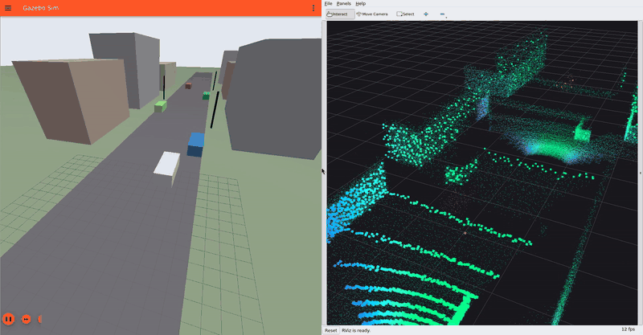

# Examples

## Street demo: Gazebo + RViz



An ego car with a forward 4D radar drives down a street lined with buildings, parked
cars and street lights, while a red car comes the other way. Gazebo (left) shows
the scene; RViz (right) shows what the radar reports.

```bash
ros2 launch gazebo_4d_radar_plugin radar_street_demo.launch.py
```

| Launch argument | Default | Effect |
|---|---|---|
| `gui` | `true` | Gazebo GUI (`false` runs the server only) |
| `rviz` | `true` | Start RViz with the demo config |
| `drive` | `true` | Run the looping scenario (`scripts/demo_driver.py`) |
| `follow` | `true` | Gazebo camera chases the ego car |

Requires `ros-jazzy-rviz2` in addition to the package dependencies.

### Reading the RViz view

- **Bright squares**: the current radar scan, coloured by measured Doppler
  (range-rate) on a −14 … +2 m/s rainbow scale.
- **Faint dots**: a 4-second trail of earlier scans, drawn in the world frame, so the
  street builds up as the car drives. This uses the plugin's `<publish_tf>` option,
  which broadcasts `world → radar_link` from the true radar pose.
- **Green / cyan**: static objects. They "approach" at the ego car's own speed
  (−6 m/s × cos of the angle), so the whole static world sits in one colour band.
  The ground close to the car is bluer because it is seen at a steeper angle.
- **Orange**: the oncoming car. It closes at 6 + 7 = 13 m/s, so its returns sit at
  the far end of the scale. Separating it from the static world needs no tracking,
  just the Doppler of a single scan. This is what an ego-velocity estimator's RANSAC
  exploits: the oncoming car's returns are its outliers.
- **Scattered single dots** in odd colours: the configured Poisson false detections
  (3 per scan).

### Files

| File | What it is |
|---|---|
| `worlds/radar_street_demo.sdf` | The scene, with the radar plugin on `ego_vehicle` |
| `launch/radar_street_demo.launch.py` | Starts Gazebo, RViz and the driver |
| `rviz/radar_street_demo.rviz` | RViz layout: live scan + trail, chase camera on `radar_link` |
| `scripts/demo_driver.py` | Loops the scenario with `gz topic` / `gz service` (works with any running `gz sim`) |

To show the RViz Displays panel (hidden in this layout), use **Panels → Displays**.

### Recording your own clip

The GIF above was recorded headless with Xvfb + ffmpeg (software rendering) at
1920 × 1000, then cut to one 11.5 s lap. A full-quality MP4 is in
[`docs/media/radar_street_demo.mp4`](../../docs/media/radar_street_demo.mp4).
